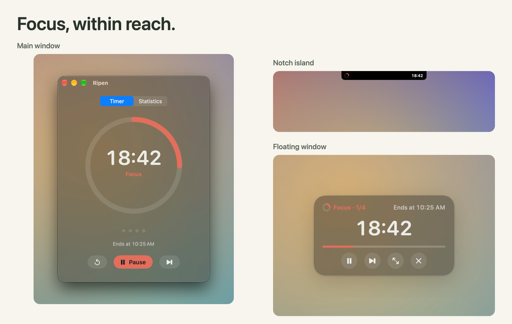
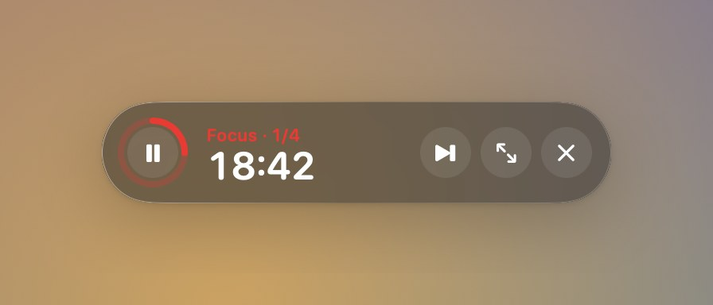
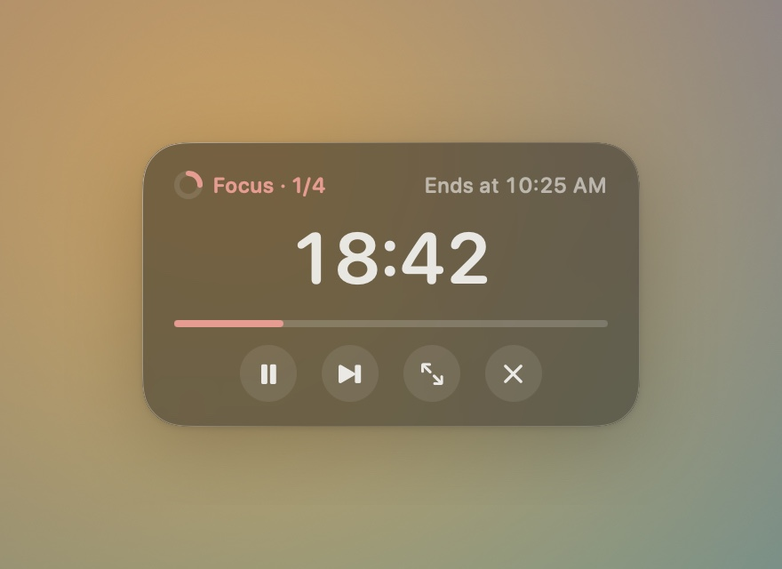
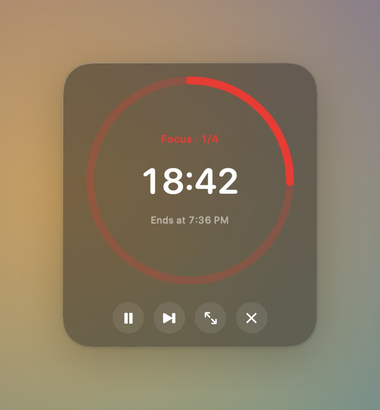
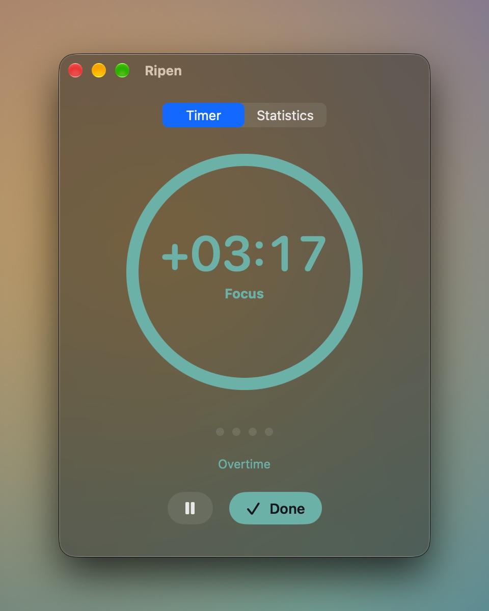
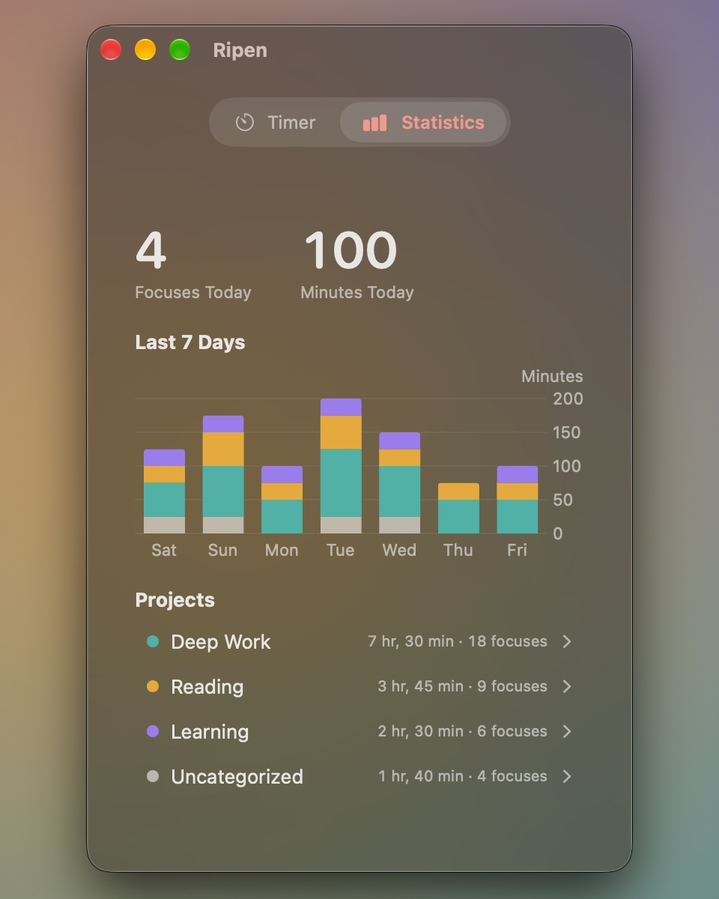

<div align="center">



# Ripen

**A little space for focus.**

A native macOS Pomodoro timer with frosted glass, floating windows, and a home in your notch.

[](https://github.com/latteine1217/ripen/releases/latest)
[](#install)
[](https://github.com/latteine1217/ripen/actions/workflows/ci.yml)
[](LICENSE)

English · [繁體中文](README.zh-Hant.md)

[Website (繁體中文 / English)](https://latteine1217.github.io/ripen/) · [Installation](#install) · [Features](#features) · [Releases](https://github.com/latteine1217/ripen/releases) · [Report an issue](https://github.com/latteine1217/ripen/issues)



</div>

Keep your timer in view and your attention on your work. Ripen follows your focus-and-break rhythm, remembers where you put it, and keeps counting when you need a little longer. Your focus history stays on your Mac.

> Download the latest version from [GitHub Releases](https://github.com/latteine1217/ripen/releases/latest). Once installed, **Check for Updates…** in the Ripen menu installs newer versions for you.

## Highlights

### Shrink it to a floating window

Click the yellow button, or drag the timer ring out of the main window, to get a small always-on-top panel. Drag any corner to switch between three layouts; Ripen remembers where you left it.

<p align="center">
  
  
  
</p>

### Tuck it into the notch

Click the red button, or drag the main window up into the notch, and Ripen becomes a black island around the camera: progress on the left, time on the right. Hover to see the full controls; pull it down to bring the main window back. On a Mac without a notch, the island sits at the top center of the screen.

<p align="center">
  
  
</p>

### Overtime instead of interruption

When the countdown reaches zero, Ripen plays a sound and keeps counting as `+mm:ss` in a new color: teal for focus, orange for breaks. Press **Done** when you are ready, and the focus is recorded with its real length. Time you spend away from your Mac is not counted as overtime.

<p align="center">
  
</p>

### See your week

The Statistics page shows today's focus count and minutes, a seven-day chart stacked by project color, and each project's total time. Open a project to see its totals, its last seven days and every completed focus, and to pick its color from the preset palette. Each project also has a recap card: its latest total, today's time, focus count, focus days and last seven days, in a square (1:1) or portrait (9:16) layout. You can hide the project name, then save the card as a PNG, copy the image, or share it through the macOS share menu once none of its focuses can still be undone. The share menu only lists services installed on your Mac; Instagram and Threads usually have none, so save or copy the image and upload it yourself. Ripen never posts for you. Everything is stored locally on your Mac.

<p align="center">
  
</p>

<p align="center"><sub>Illustrative focus history for demonstration, not real user data.</sub></p>

## Features

| Feature | Details |
| :--- | :--- |
| Your rhythm | 25-minute focus, 5-minute short break, 15-minute long break after every 4 focuses. Adjust each length from 1–180 minutes and the long-break interval from 1–12. |
| Quick control | <kbd>⌥</kbd><kbd>⌘</kbd><kbd>P</kbd> to start or pause from any app, or record your own shortcut. In the main window: <kbd>⌘</kbd><kbd>S</kbd> to skip or finish, <kbd>⌘</kbd><kbd>R</kbd> to reset, <kbd>⌘</kbd><kbd>1</kbd> / <kbd>⌘</kbd><kbd>2</kbd> to switch between Timer and Statistics. Skip, reset and Done can be undone for 5 seconds from the countdown capsule or <kbd>⌘</kbd><kbd>Z</kbd>. |
| Make it yours | Black, White, or Glass appearance; glass can follow the system or stay light or dark, with adjustable opacity and blur. System reminder sounds or silence, optional auto-start and open at login, and 12- or 24-hour end times. |
| Projects | Pick a project from the menu above the timer ring, or add one by typing its name; each gets a color from a preset palette. Before you start, the project's total time and focus count show below the menu. Start uncategorized if you like, and change the project mid-focus to move the whole focus; a choice made during a break applies to the next focus. |
| Always at hand | Three floating-window layouts, a notch island, and an optional menu bar countdown. |
| A fresh start | The long-break count resets after two hours idle. |
| Easy to learn | A short intro shows the tear-off, notch and resize gestures on first launch, with one-time tips where they apply. Replay it from Settings. |
| Local and private | No account needed, and Ripen only goes online when you click **Check for Updates…**; a newer release is downloaded, verified against GitHub's checksum and installed only after you confirm. Focus history stays in `~/Library/Application Support/Ripen`. English and Traditional Chinese included. |

## Install

Ripen requires macOS 14 Sonoma or later.

1. Install with [Homebrew](https://brew.sh):

   ```sh
   brew install --cask latteine1217/tap/ripen
   ```

   Or download `Ripen-<version>.dmg` from [GitHub Releases](https://github.com/latteine1217/ripen/releases), open it, and drag **Ripen** onto the **Applications** shortcut.
2. Ripen is ad-hoc signed and not notarized by Apple, so Gatekeeper blocks the first launch:
   - **macOS 14**: in the Applications folder, right-click (or Control-click) Ripen, choose **Open**, then click **Open** in the dialog.
   - **macOS 15 and later**: double-click Ripen so macOS blocks it, then open **System Settings › Privacy & Security**, find Ripen near the bottom, click **Open Anyway**, and confirm.

After that, Ripen opens normally. Release notes for every version are in the [changelog](CHANGELOG.md).

## Roadmap

- Liquid Glass on macOS 26 and later
- Shortcuts app support

## Support

If Ripen helps you focus, you can support its development on Ko-fi.

<a href="https://ko-fi.com/latteine1217"></a>

Bug reports and ideas are welcome in [Issues](https://github.com/latteine1217/ripen/issues). Please report security issues privately, as described in [SECURITY.md](SECURITY.md).

## Development

Building, testing, packaging, the project layout, and architecture notes on presentation transitions and timer display sampling are covered in [docs/development.md](docs/development.md). See [CONTRIBUTING.md](CONTRIBUTING.md) before opening a pull request.

## License

[MIT](LICENSE)
