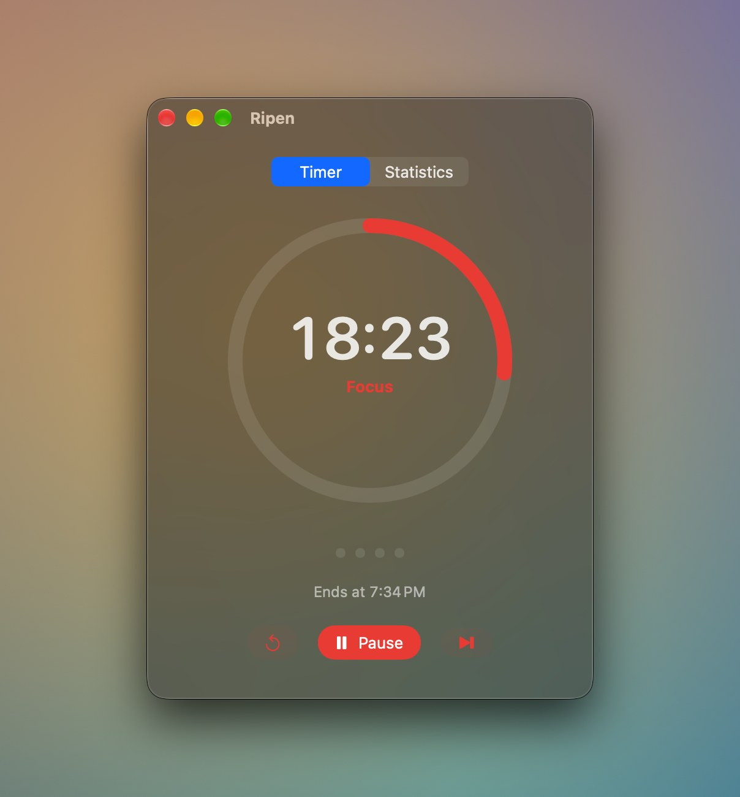

# Ripen

**A frosted-glass Pomodoro timer for macOS that lives where you need it: a window, a floating panel, or your notch.**

English · [繁體中文](README.zh-Hant.md)

Ripen is a native Swift app for the classic focus-and-break rhythm. It stays small, stays on screen without getting in the way, and when a focus session runs long it keeps counting instead of cutting you off.

> Ripen is in active development. The first release will be published on [GitHub Releases](https://github.com/latteine1217/ripen/releases).

## Highlights

### Shrink it to a floating window

Click the yellow button, or drag the timer ring out of the main window, to get a small always-on-top panel. Drag any corner to switch between three layouts; Ripen remembers where you left it.

  
  
  

### Tuck it into the notch

Click the red button, or drag the main window up into the notch, and Ripen becomes a black island around the camera: progress on the left, time on the right. Hover to see the full controls; pull it down to bring the main window back. On a Mac without a notch, the island sits at the top center of the screen.

  
  

### Overtime instead of interruption

When the countdown reaches zero, Ripen plays a sound and keeps counting as `+mm:ss` in a new color: teal for focus, orange for breaks. Press **Done** when you are ready, and the focus is recorded with its real length. Time you spend away from your Mac is not counted as overtime.

  

### See your week

The Statistics page shows today's focus count and minutes, plus a chart of the last seven days. Everything is stored locally on your Mac.

  

## Features

- **Pomodoro cycle**: 25-minute focus, 5-minute short break, and a 15-minute long break after every 4 focuses. Every length (1–180 minutes) and the long-break interval (1–12) can be changed.
- **Global shortcut**: start or pause from any app with <kbd>⌥</kbd><kbd>⌘</kbd><kbd>P</kbd>, or record your own.
- **Keyboard control** in the main window: <kbd>⌘</kbd><kbd>S</kbd> to skip (or finish during overtime) and <kbd>⌘</kbd><kbd>R</kbd> to reset.
- **Menu bar item** with the remaining time, which can be hidden in Settings.
- **Reminder sound** chosen from the macOS system sounds, or turned off.
- **Optional auto-start** of the next phase, **open at login**, and a 12- or 24-hour clock for end times.
- **Adjustable glass**: change the tint opacity or turn off the background blur.
- **Fresh start after a break**: after two hours idle, the long-break count resets.
- **Private by design**: no account and no network access. Your focus history stays in `~/Library/Application Support/Ripen`.
- Available in **English** and **Traditional Chinese**.

## Install

1. Download `Ripen-<version>.dmg` from [GitHub Releases](https://github.com/latteine1217/ripen/releases). Ripen requires macOS 14 Sonoma or later.
2. Open the dmg and drag **Ripen** onto the **Applications** shortcut.
3. Ripen is ad-hoc signed and not notarized by Apple, so Gatekeeper blocks the first launch:
   - **macOS 14**: in the Applications folder, right-click (or Control-click) Ripen, choose **Open**, then click **Open** in the dialog.
   - **macOS 15 and later**: double-click Ripen so macOS blocks it, then open **System Settings › Privacy & Security**, find Ripen near the bottom, click **Open Anyway**, and confirm.

After that, Ripen opens normally.

## Roadmap

- Light appearance that follows the system setting
- Liquid Glass on macOS 26 and later
- Shortcuts app support

## Support

If Ripen helps you focus, you can support its development on [Ko-fi](https://ko-fi.com/latteine1217). Bug reports and ideas are welcome in [Issues](https://github.com/latteine1217/ripen/issues).

## Development

Building, testing, packaging, and the project layout are covered in [docs/development.md](docs/development.md).

## License

[MIT](LICENSE)
