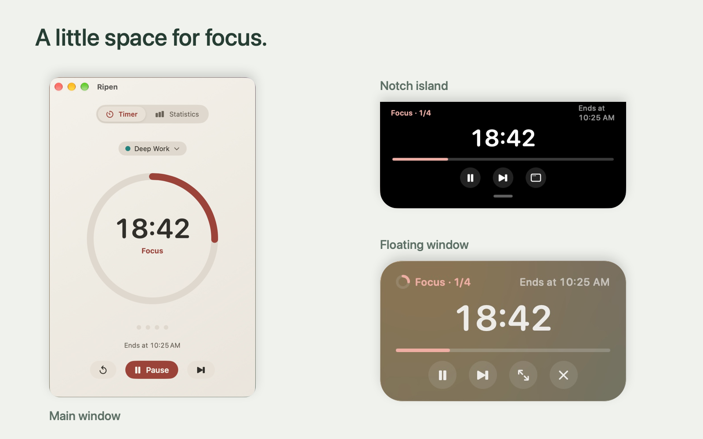
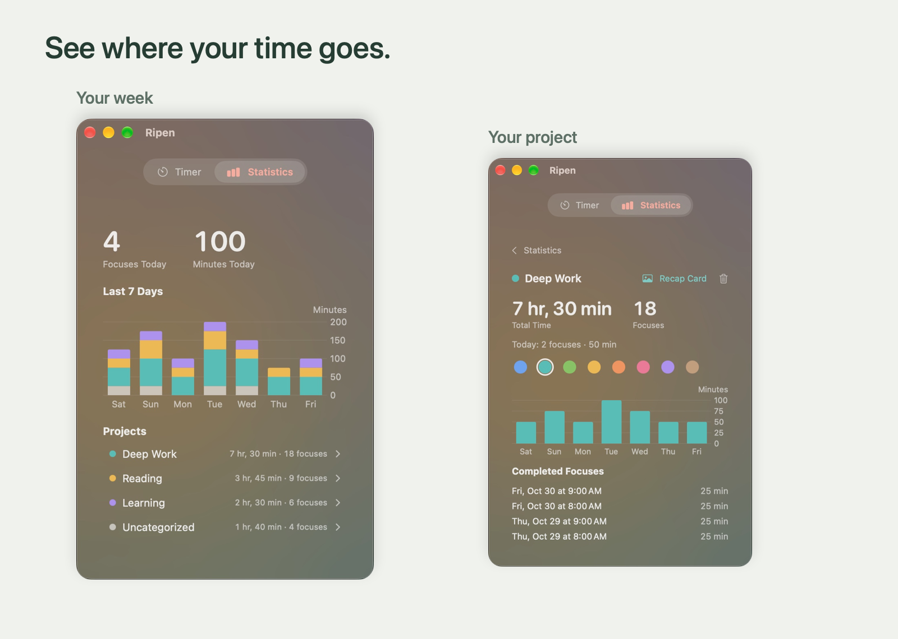
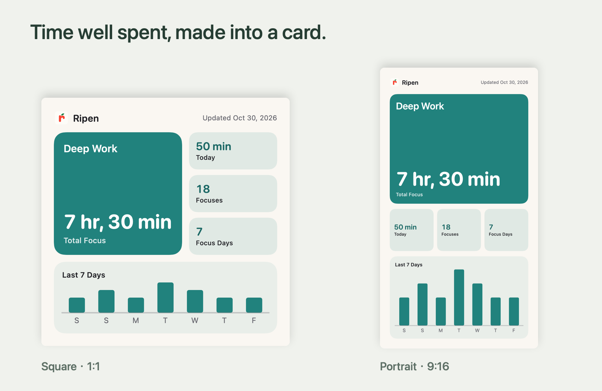

<div align="center">


# Ripen

**A little space for focus.**

A native macOS Pomodoro timer with projects, focus statistics, and a home in your notch.

[](https://github.com/latteine1217/ripen/releases/latest)
[](#install)
[](https://github.com/latteine1217/ripen/actions/workflows/ci.yml)
[](LICENSE)

English · [繁體中文](README.zh-Hant.md)

[Website (繁體中文 / English)](https://latteine1217.github.io/ripen/) · [Installation](#install) · [Features](#features) · [Releases](https://github.com/latteine1217/ripen/releases) · [Report an issue](https://github.com/latteine1217/ripen/issues)

</div>

> v0.2.0 is out · [Release notes](https://github.com/latteine1217/ripen/releases/tag/v0.2.0)

<p align="center">
  
</p>

Keep your timer in view and your attention on your work. Ripen follows your focus-and-break rhythm, organizes your time by project, and turns your progress into a recap card. Your focus history stays on your Mac.

## Features

### Give each kind of work a project

Work, reading, or something you are learning can each have a project and a color. Open the menu above the timer ring to choose a project, or type a name and choose a color to add one. Before you start, its total time and completed focus count appear below the menu.

You can start with Uncategorized. Change projects during a focus to move the whole focus to the new project; a choice made during a break applies to the next focus.

### See where your time goes

Statistics stacks your last seven days of focus time by project color, alongside today's focus count and minutes and each project's total. Open a project to see its total time, its last week and every completed focus, or choose a different color from the palette.

If you no longer need a project, delete it from its detail page. After you confirm, its records move to Uncategorized, keeping their time and counts.

<p align="center">
  
  <br><sub>Illustrative focus history for demonstration, not real user data.</sub>
</p>

### Turn your progress into a recap card

Every project with completed focuses, including Uncategorized, has a recap card showing total time, today's time, focus count, focus days and the last seven days. Open it from the project details, choose a square (1:1) or portrait (9:16) layout, and hide the project name if you like.

Once the records are saved and their undo period has passed, save the card as a PNG, copy the image, or use the macOS share menu. Refresh the card if its records change after you open it. To post on a social platform, you can save the image and upload it yourself.

<p align="center">
  
  <br><sub>Recap cards use demonstration data, not real user records.</sub>
</p>

### Shrink it to a floating window

Click the yellow button, or drag the timer ring out of the main window, to get a small always-on-top panel. Drag any corner to switch between three layouts; Ripen remembers where you left it.

<p align="center">
  
</p>

<details>
<summary>See the other floating-window sizes</summary>

<p align="center">
  
</p>
<p align="center">
  
</p>

</details>

### Tuck it into the notch

Click the red button, or drag the main window up into the notch, and Ripen becomes a black island around the camera: progress on the left, time on the right. Hover to see the full controls; pull it down to bring the main window back. On a Mac without a notch, the island sits at the top center of the screen.

<p align="center">
  
</p>

### Finish at your own pace

When the countdown reaches zero, Ripen plays a sound and keeps counting as `+mm:ss`: teal for focus, orange for breaks. Press **Done** when you are ready to record the focus's actual length. Time away from your Mac is not counted as overtime.

The main window, floating window and notch island briefly show the time you just spent and your project's total. During the following break, you can open that project's recap card directly.

<details>
<summary>See overtime in action</summary>

<p align="center">
  
</p>

</details>

## Everyday controls and settings

| Feature | Details |
| :--- | :--- |
| Your rhythm | Defaults to a 25-minute focus, a 5-minute short break and a 15-minute long break after every 4 focuses. Adjust each length from 1–180 minutes and the long-break interval from 1–12. The long-break count resets after two hours idle. |
| Quick control | <kbd>⌥</kbd><kbd>⌘</kbd><kbd>P</kbd> to start or pause from any app, or record your own shortcut. In the main window: <kbd>⌘</kbd><kbd>S</kbd> to skip or finish, <kbd>⌘</kbd><kbd>R</kbd> to reset, <kbd>⌘</kbd><kbd>1</kbd> / <kbd>⌘</kbd><kbd>2</kbd> to switch between Timer and Statistics. |
| Undo | Undo skip, reset or Done for 5 seconds from the countdown capsule or <kbd>⌘</kbd><kbd>Z</kbd>. |
| Appearance and reminders | Black, White, or Glass appearance; glass can follow the system or stay light or dark, with adjustable opacity and blur. System reminder sounds or silence, an optional menu bar countdown, and 12- or 24-hour end times. |
| Startup and guidance | Optional auto-start for the next phase and open at login. A first-launch intro shows the tear-off, notch and resize gestures; replay it from Settings. |
| Local and private | No account needed. Focus history stays in `~/Library/Application Support/Ripen`, with English and Traditional Chinese interfaces. Ripen only goes online when you click **Check for Updates…**; updates are downloaded after confirmation and verified against GitHub's checksum before installation. |

## Install

Ripen requires macOS 14 Sonoma or later.

1. Install with [Homebrew](https://brew.sh):

   ```sh
   brew install --cask latteine1217/tap/ripen
   ```

   Or download `Ripen-<version>.dmg` from [GitHub Releases](https://github.com/latteine1217/ripen/releases), open it, and drag **Ripen** onto the **Applications** shortcut.
2. Ripen is ad-hoc signed and not notarized by Apple, so Gatekeeper blocks the first launch:
   - **macOS 14**: in the Applications folder, right-click (or Control-click) Ripen, choose **Open**, then click **Open** in the dialog.
   - **macOS 15 and later**: double-click Ripen so macOS blocks it, then open **System Settings › Privacy & Security**, find Ripen near the bottom, click **Open Anyway**, and confirm.

After that, Ripen opens normally. Release notes for every version are in the [changelog](CHANGELOG.md).

## Roadmap

- Liquid Glass on macOS 26 and later
- Shortcuts app support

## Support

If Ripen helps you focus, you can support its development on Ko-fi.

<a href="https://ko-fi.com/latteine1217"></a>

Bug reports and ideas are welcome in [Issues](https://github.com/latteine1217/ripen/issues). Please report security issues privately, as described in [SECURITY.md](SECURITY.md).

## Development

Building, testing, packaging, the project layout, and architecture notes on presentation transitions and timer display sampling are covered in [docs/development.md](docs/development.md). See [CONTRIBUTING.md](CONTRIBUTING.md) before opening a pull request.

## License

[MIT](LICENSE)
