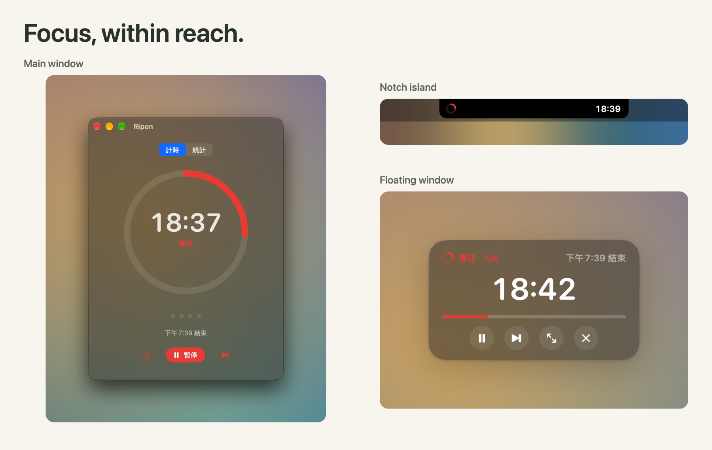
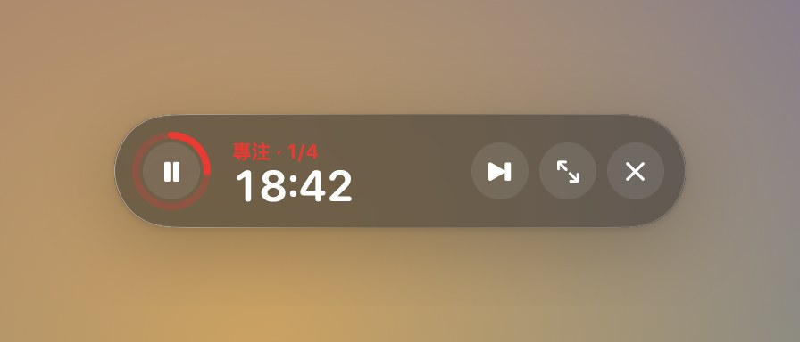
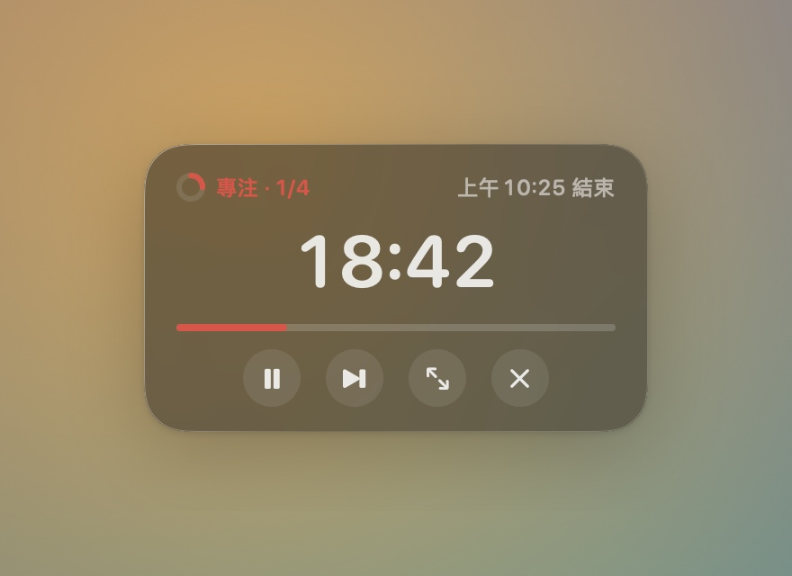
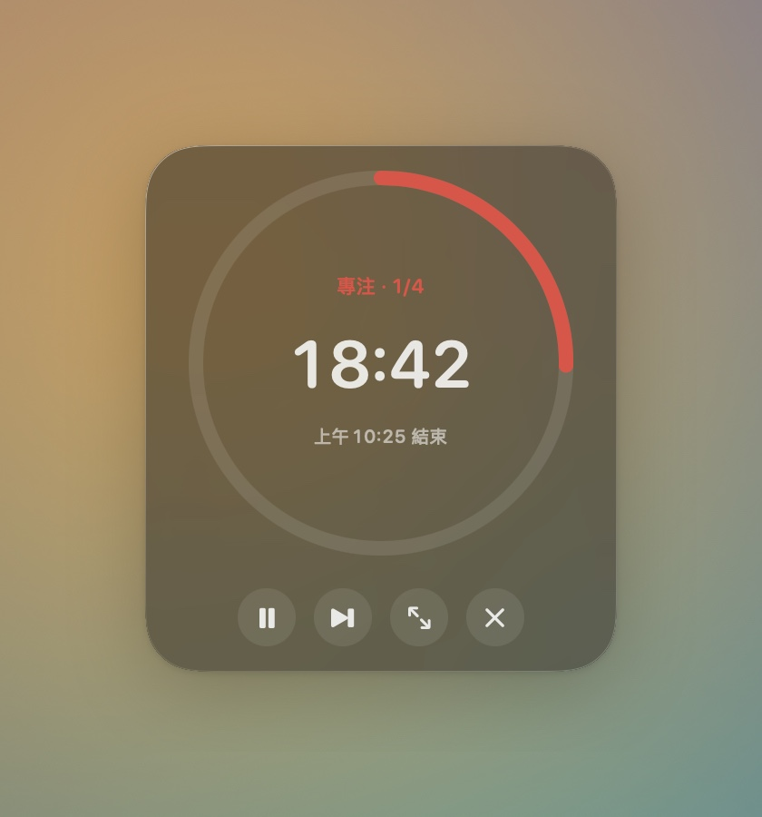
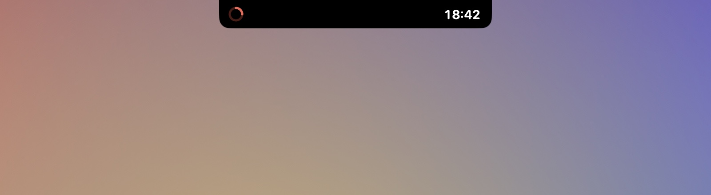
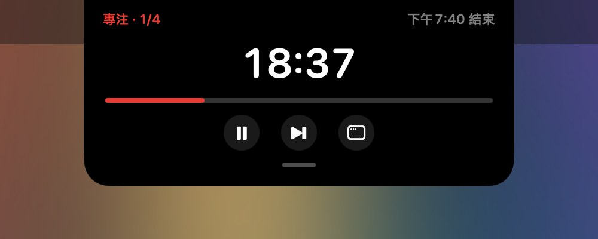
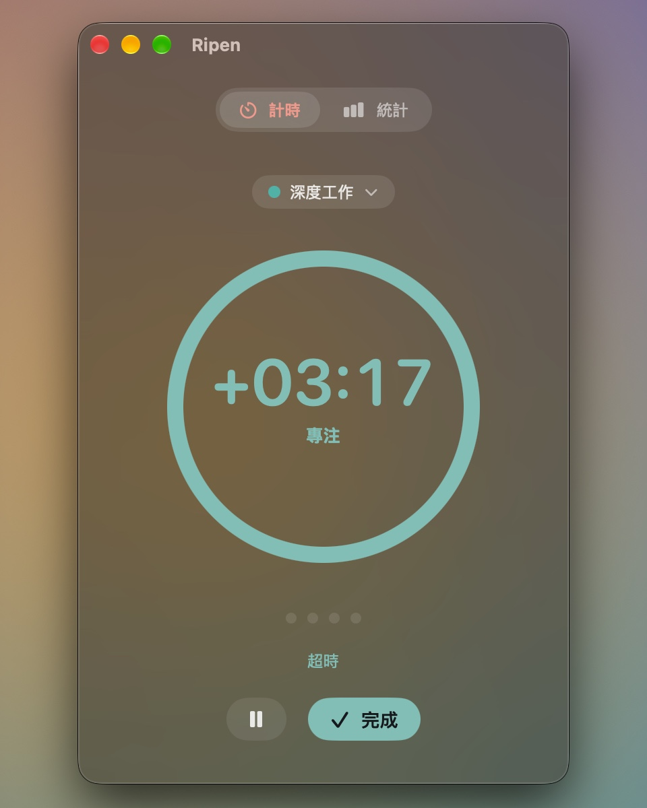
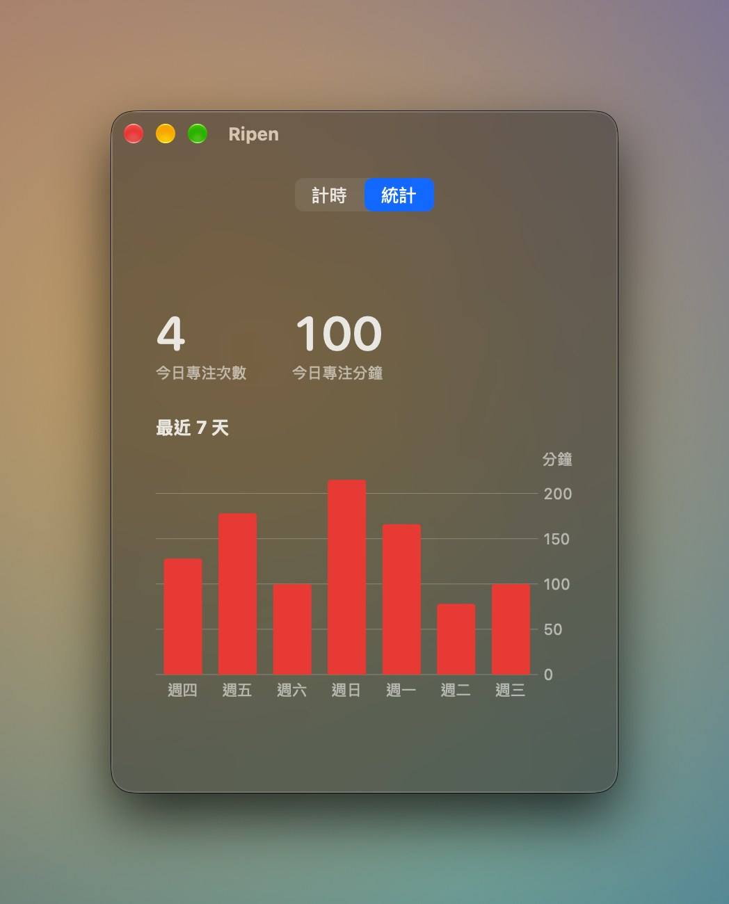

# Ripen

**留一點空間，給專注。**

原生 macOS 番茄鐘，以磨砂玻璃呈現，放在主視窗、懸浮窗，或你的螢幕瀏海。

[English](README.md) · 繁體中文

[安裝方式](#安裝) · [完整功能](#功能) · [版本下載](https://github.com/latteine1217/ripen/releases) · [問題回報](https://github.com/latteine1217/ripen/issues)

讓計時留在視線裡，把注意力留給手上的事。Ripen 跟著專注與休息的節奏走，記住你放的位置；需要多一點時間時，就繼續計時。專注紀錄只留在你的 Mac 上。

> Ripen 仍在開發中，第一個版本會發佈在 [GitHub Releases](https://github.com/latteine1217/ripen/releases)。

## 特色

### 縮成懸浮窗

按黃色按鈕，或把計時圓環從主視窗拖出來，就會變成置頂的小懸浮窗。拖曳任一角可以在三種版面之間切換，Ripen 會記住你放的位置。

  
  
  

### 收進瀏海

按紅色按鈕，或把主視窗往上拖進瀏海，Ripen 就變成圍著鏡頭的黑色瀏海島：左邊是進度，右邊是時間。滑鼠移上去會展開完整控制，往下拉就變回主視窗。沒有瀏海的 Mac 上，瀏海島會出現在螢幕頂端中央。

  
  

### 超時，而不是打斷

倒數到 0 時 Ripen 會播提示音，接著換個顏色以 `+mm:ss` 繼續計時：專注是青綠色，休息是橘色。準備好了再按「完成」，這次專注會以實際長度記錄。離開電腦的時間不算進超時。

  

### 看見這一週

統計頁顯示今天的專注次數與分鐘數，以及最近 7 天的長條圖。所有資料只存在你的 Mac 上。

  

## 功能

| 功能 | 說明 |
| :--- | :--- |
| 你的節奏 | 專注 25 分、短休息 5 分，每 4 次專注後長休息 15 分。各段長度可設為 1–180 分，長休息間隔可設為 1–12 次。 |
| 快速操作 | 在任何 App 中按 <kbd>⌥</kbd><kbd>⌘</kbd><kbd>P</kbd> 開始或暫停，也可錄製自己的組合。主視窗支援 <kbd>⌘</kbd><kbd>S</kbd> 跳過或完成、<kbd>⌘</kbd><kbd>R</kbd> 重設。 |
| 自訂習慣 | 可調整玻璃不透明度與模糊、選擇系統提示音或靜音、自動開始下一段、登入時開啟，以及 12 或 24 小時制的結束時刻。 |
| 隨時看得到 | 三種懸浮窗版面、瀏海島，以及可選擇顯示的選單列倒數。 |
| 休息後重新開始 | 閒置兩小時後，長休息的計數歸零。 |
| 本機與隱私 | 不需要帳號、不連網路。專注紀錄存在 `~/Library/Application Support/Ripen`，提供英文與繁體中文介面。 |

## 安裝

1. 從 [GitHub Releases](https://github.com/latteine1217/ripen/releases) 下載 `Ripen-<version>.dmg`（需要 macOS 14 Sonoma 以上）。
2. 打開 dmg，把 **Ripen** 拖到 **Applications** 捷徑上。
3. Ripen 只有 ad-hoc 簽章、未經 Apple 公證，第一次打開會被 Gatekeeper 擋下：
   - **macOS 14**：在「應用程式」資料夾對 Ripen 按右鍵（或 Control 點按）選「打開」，再於對話框按「打開」。
   - **macOS 15 以上**：先雙擊 Ripen 讓系統擋下，再到「系統設定 › 隱私權與安全性」，在下方找到 Ripen 按「強制打開」並確認。

之後就能正常雙擊打開。

## 接下來

- 依系統設定切換的淺色外觀
- macOS 26 以上改用 Liquid Glass
- 支援「捷徑」App

## 支持

如果 Ripen 幫助你專注，歡迎透過 Ko-fi 支持開發。

問題回報與建議請到 [Issues](https://github.com/latteine1217/ripen/issues)。

## 開發

建置、測試、打包與專案結構見 [docs/development.md](docs/development.md)。

## 授權

[MIT](LICENSE)
