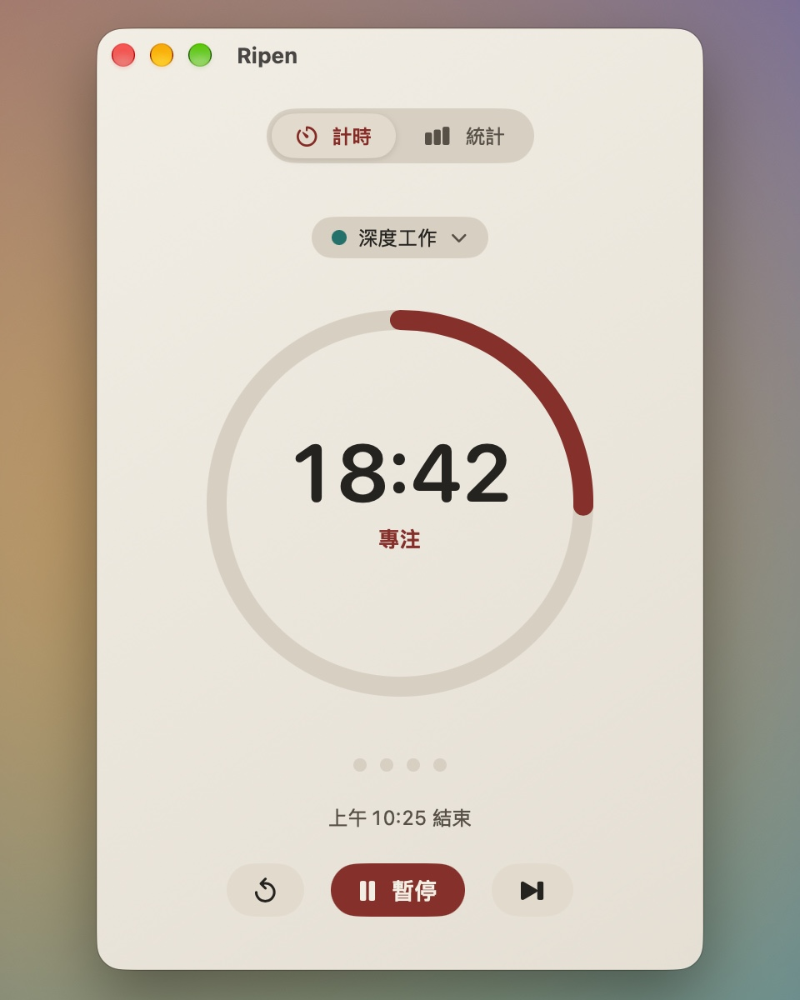
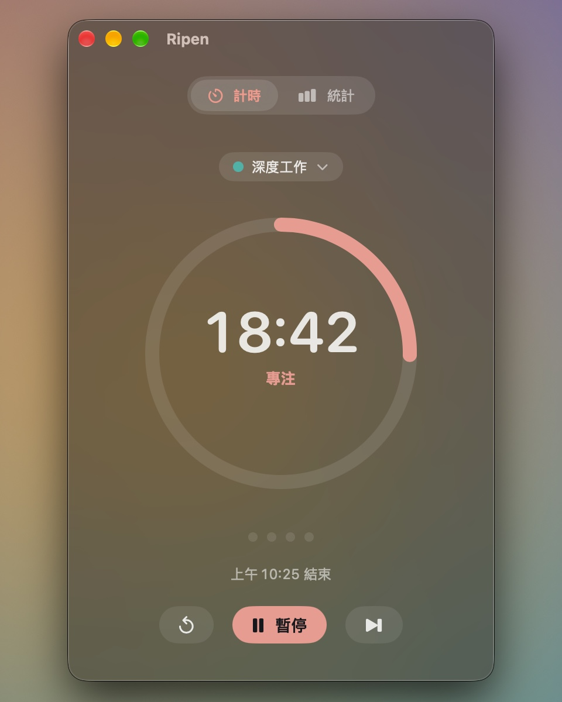
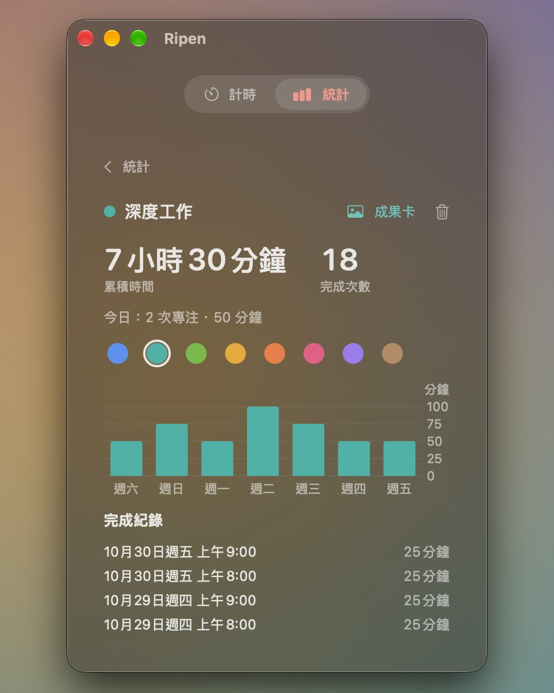
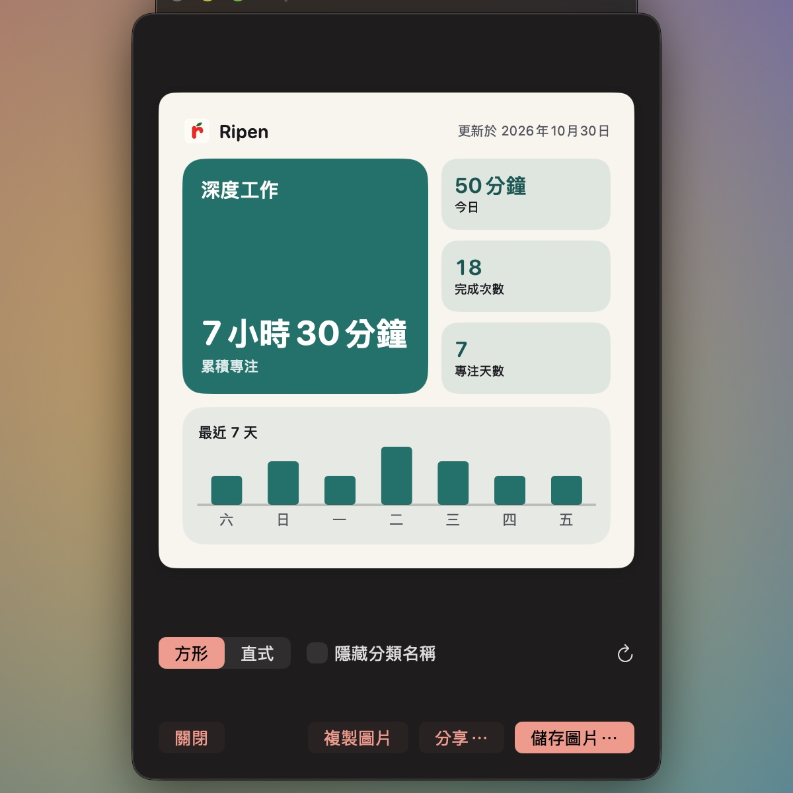
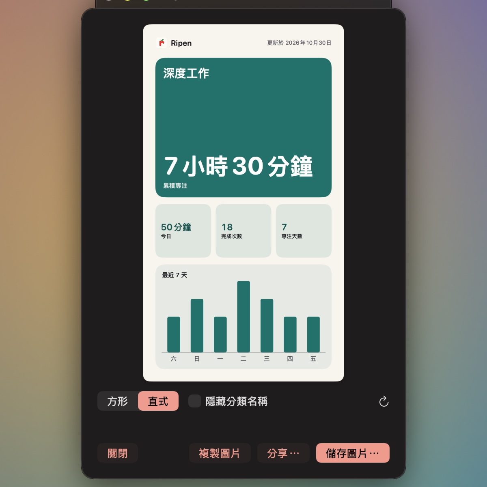

<div align="center">


# Ripen

**留一點空間，給專注。**

原生 macOS 番茄鐘，依分類累積專注，放在主視窗、懸浮窗，或你的螢幕瀏海。

[](https://github.com/latteine1217/ripen/releases/latest)
[](#安裝)
[](https://github.com/latteine1217/ripen/actions/workflows/ci.yml)
[](LICENSE)

[English](README.md) · 繁體中文

[產品介紹（繁體中文 / English）](https://latteine1217.github.io/ripen/) · [安裝方式](#安裝) · [完整功能](#功能) · [版本下載](https://github.com/latteine1217/ripen/releases) · [問題回報](https://github.com/latteine1217/ripen/issues)

</div>

> v0.2.0 已發布 · [更新內容](https://github.com/latteine1217/ripen/releases/tag/v0.2.0)

<p align="center">
  
</p>

讓計時留在視線裡，把注意力留給手上的事。Ripen 跟著專注與休息的節奏走，讓你依分類累積投入、回顧一週，再把成果存成一張卡。所有專注紀錄只留在你的 Mac 上。

## 功能

### 為每一種投入建立分類

工作、閱讀，或正在學的新事物，都可以有自己的分類與代表色。在計時圓環上方打開分類選單，選擇既有分類，或輸入名稱並從色盤選色來新增。開始前，選單下方會顯示這個分類的累積時間與完成次數。

可以選「未分類」直接開始。專注途中切換分類，整次專注會歸入新分類；休息時選擇的分類則用於下一次專注。

<p align="center">
  
</p>

### 看見時間花在哪裡

統計頁以分類代表色堆疊最近 7 天的專注時間，並列出今天的完成次數、分鐘數與各分類的累積。點進分類，就能查看它的總投入、最近一週與每一筆完成紀錄，也能從色盤更換代表色。

不再需要某個分類時，可在詳情頁刪除；確認後，原有紀錄會移到「未分類」，時間與次數都會保留。

<p align="center">
  
  
  <br><sub>統計畫面使用展示資料，非真實使用者紀錄。</sub>
</p>

### 把累積做成一張成果卡

每個有完成紀錄的分類（含未分類）都有一張成果卡，呈現累積時間、今日投入、完成次數、專注天數與最近 7 天。從分類詳情開啟，選擇方形（1:1）或直式（9:16）版型，也可以隱藏分類名稱。

紀錄儲存完成且已過復原期限後，即可存成 PNG、複製圖片，或使用 macOS 分享選單。若開卡後紀錄有變動，重新整理即可更新；要貼到社群平台，也可以先存圖再自行上傳。

<p align="center">
  
  
  <br><sub>成果卡使用展示資料，非真實使用者紀錄。</sub>
</p>

### 縮成懸浮窗

按黃色按鈕，或把計時圓環從主視窗拖出來，就會變成置頂的小懸浮窗。拖曳任一角可以在三種版面之間切換，Ripen 會記住你放的位置。

<p align="center">
  
  
  
</p>

### 收進瀏海

按紅色按鈕，或把主視窗往上拖進瀏海，Ripen 就變成圍著鏡頭的黑色瀏海島：左邊是進度，右邊是時間。滑鼠移上去會展開完整控制，往下拉就變回主視窗。沒有瀏海的 Mac 上，瀏海島會出現在螢幕頂端中央。

<p align="center">
  
  
</p>

### 按自己的步調完成

倒數到 0 時，Ripen 會播提示音，再以 `+mm:ss` 繼續計時：專注是青綠色，休息是橘色。準備好了再按「完成」，這次專注會以實際長度記錄，離開電腦的時間不算進超時。

完成後，主視窗、懸浮窗與瀏海島都會短暫顯示本次投入與分類累積。接下來的休息期間，可以直接開啟剛完成分類的成果卡。

<p align="center">
  
</p>

## 日常操作與設定

| 功能 | 說明 |
| :--- | :--- |
| 你的節奏 | 預設專注 25 分、短休息 5 分，每 4 次專注後長休息 15 分。各段長度可設為 1–180 分，長休息間隔可設為 1–12 次；閒置兩小時後，長休息的計數歸零。 |
| 快速操作 | 在任何 App 中按 <kbd>⌥</kbd><kbd>⌘</kbd><kbd>P</kbd> 開始或暫停，也可錄製自己的組合。主視窗支援 <kbd>⌘</kbd><kbd>S</kbd> 跳過或完成、<kbd>⌘</kbd><kbd>R</kbd> 重設，<kbd>⌘</kbd><kbd>1</kbd>／<kbd>⌘</kbd><kbd>2</kbd> 切換計時頁與統計頁。 |
| 復原操作 | 跳過、重設與完成之後 5 秒內，可以按倒數膠囊或 <kbd>⌘</kbd><kbd>Z</kbd> 復原。 |
| 外觀與提醒 | 黑、白、玻璃外觀；玻璃可跟隨系統或指定深淺色，並調整不透明度與模糊。可選系統提示音或靜音、選單列倒數，以及 12 或 24 小時制的結束時刻。 |
| 啟動與引導 | 可自動開始下一段、登入時開啟。首次啟動有拖出懸浮窗、收進瀏海與調整尺寸的手勢介紹，可從設定重播。 |
| 本機與隱私 | 不需要帳號；專注紀錄存在 `~/Library/Application Support/Ripen`，提供英文與繁體中文介面。只有按「檢查更新⋯」時才連網，更新經確認後下載，核對 GitHub 提供的檢查碼後安裝。 |

## 安裝

需要 macOS 14 Sonoma 以上。

1. 以 [Homebrew](https://brew.sh) 安裝：

   ```sh
   brew install --cask latteine1217/tap/ripen
   ```

   或從 [GitHub Releases](https://github.com/latteine1217/ripen/releases) 下載 `Ripen-<version>.dmg`，打開後把 **Ripen** 拖到 **Applications** 捷徑上。
2. Ripen 只有 ad-hoc 簽章、未經 Apple 公證，第一次打開會被 Gatekeeper 擋下：
   - **macOS 14**：在「應用程式」資料夾對 Ripen 按右鍵（或 Control 點按）選「打開」，再於對話框按「打開」。
   - **macOS 15 以上**：先雙擊 Ripen 讓系統擋下，再到「系統設定 › 隱私權與安全性」，在下方找到 Ripen 按「強制打開」並確認。

之後就能正常雙擊打開。各版本的更新內容見 [更新紀錄](CHANGELOG.md)。

## 接下來

- macOS 26 以上改用 Liquid Glass
- 支援「捷徑」App

## 支持

如果 Ripen 幫助你專注，歡迎透過 Ko-fi 支持開發。

<a href="https://ko-fi.com/latteine1217"></a>

問題回報與建議請到 [Issues](https://github.com/latteine1217/ripen/issues)。安全性問題請依 [SECURITY.md](SECURITY.md) 私下回報。

## 開發

建置、測試、打包、專案結構，以及形態過場與計時顯示取樣的架構說明，見 [docs/development.md](docs/development.md)。送出 pull request 前請先看 [CONTRIBUTING.md](CONTRIBUTING.md)。

## 授權

[MIT](LICENSE)
